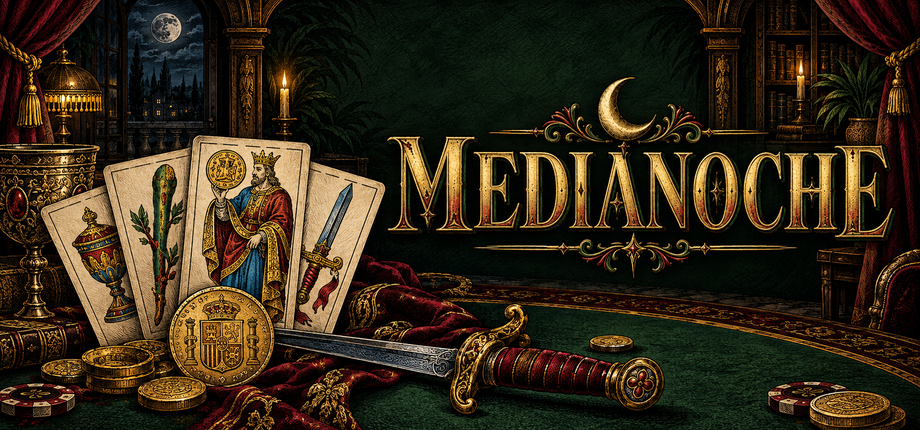
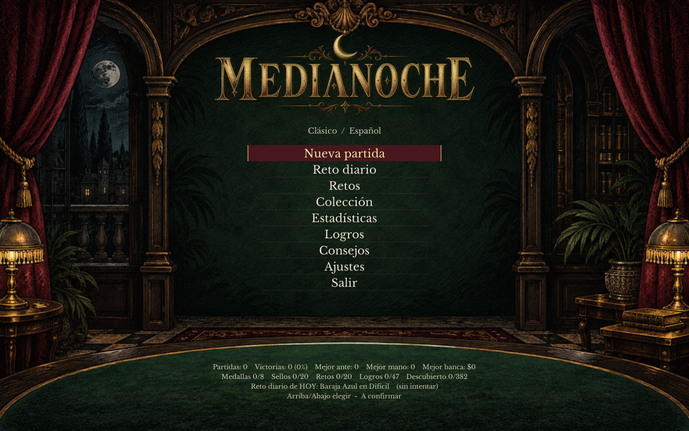

# MEDIANOCHE

Un roguelike de construcción de mazos entre cartas, ciegas y decisiones de riesgo. Encadena jugadas, combina jokers y transforma tu baraja para superar al siguiente jefe.

[Descargar la última versión](https://github.com/javieratomic/medianoche/releases/latest) · [Errores y permisos](https://github.com/javieratomic/medianoche/issues)

## Dos barajas, una noche

- **Clásico:** baraja francesa de 52 cartas y manos de póker.
- **Español:** baraja de 40 cartas, con jugadas propias basadas en el quince, la escoba y los cantes.
- **Construye tu estrategia:** jokers, consumibles, mejoras y tiendas entre ciegas; los jefes cambian las reglas.
- **Sigue más allá de la victoria:** modo infinito con corrupciones acumulativas.
- **Juega a tu manera:** mando, teclado y ratón; guardado automático para retomar la partida.

## Descargar y jugar

Versión **v0.1.0**, primera versión pública. Descarga el juego desde [Releases](https://github.com/javieratomic/medianoche/releases/latest). Elige el archivo de tu plataforma, no los archivos automáticos «Source code» de GitHub.

### Windows de 64 bits

1. [Descarga el paquete Windows x64 (.zip)](https://github.com/javieratomic/medianoche/releases/download/v0.1.0/MEDIANOCHE-0.1.0-Windows-x64.zip).
2. Extrae **todos** los archivos a una carpeta.
3. Ejecuta `MEDIANOCHE.exe` desde esa carpeta.

Windows SmartScreen puede mostrar un aviso si no reconoce el ejecutable. Comprueba que procede del repositorio oficial antes de decidir si lo ejecutas. No es necesario desactivar las protecciones de Windows.

### SteamOS / Linux de 64 bits

El paquete Linux x64 está preparado para SteamOS. Incluye un runtime de **LÖVE 11.5** y no depende de Flatpak ni requiere instalar LÖVE por separado.

1. Entra en **Modo Escritorio (Desktop Mode)** y [descarga el paquete SteamOS / Linux x64 (.tar.gz)](https://github.com/javieratomic/medianoche/releases/download/v0.1.0/MEDIANOCHE-0.1.0-SteamOS-x64.tar.gz).
2. Extráelo en una carpeta, que puede ser temporal, y **cierra Steam por completo** antes de instalar.
3. Abre `Install-MEDIANOCHE.desktop` o ejecuta `./install.sh` en una terminal desde la carpeta extraída.
4. El instalador copia el juego a `~/Games/MEDIANOCHE` y lo añade a Steam como juego externo. Instala automáticamente la cabecera (hero), el logo, las cápsulas horizontal y vertical y el icono de biblioteca.
5. Abre Steam de nuevo y vuelve al **Modo Juego (Game Mode)** para jugar desde tu biblioteca.

Una vez completada la instalación, puedes borrar la carpeta temporal extraída: Steam utiliza la copia de `~/Games/MEDIANOCHE`. No borres esa carpeta de instalación. La integración con Steam corresponde a SteamOS; no implica disponibilidad en la tienda de Steam ni compatibilidad garantizada con todas las distribuciones Linux.

## Licencia

**Gratis para jugar; no es código abierto.** Consulta las condiciones antes de distribuir o reutilizar el juego.

La monetización, la modificación, la redistribución (incluso gratuita) y la reutilización del juego o de su arte requieren permiso previo por escrito. Puedes compartir el enlace oficial de descarga. Tus ajustes, partidas guardadas y configuración están permitidos.

Consulta la [licencia completa](LICENSE.txt) y los [avisos de terceros](THIRD_PARTY_NOTICES.md). Las licencias propias de LÖVE, sus dependencias y la fuente conservan sus permisos y no quedan restringidas por la licencia del juego. Para pedir otro uso, abre una [incidencia pública](https://github.com/javieratomic/medianoche/issues).
